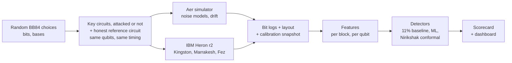
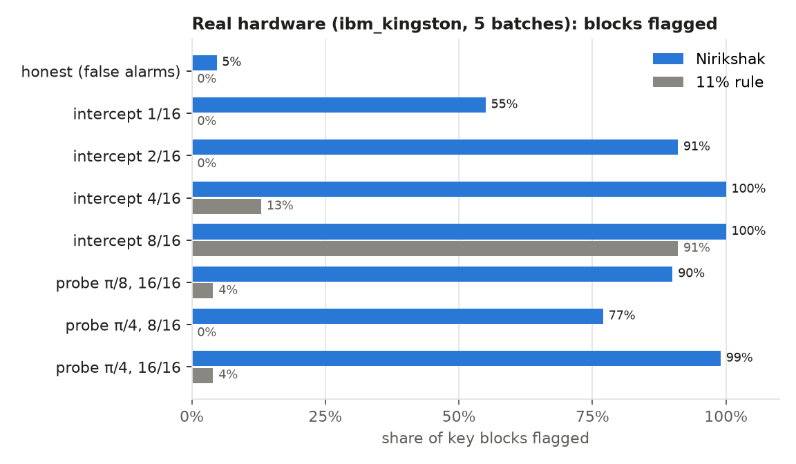
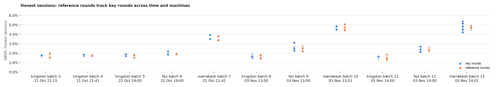
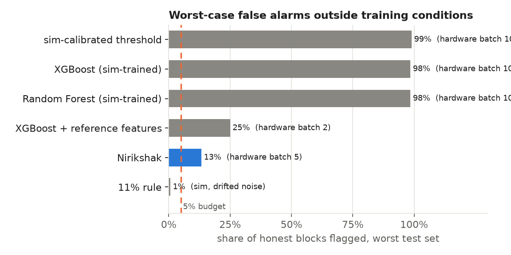

<div align="center">

# Nirikshak

**Drift-robust eavesdropper detection for BB84 quantum key distribution, tested on real quantum hardware.**

[](https://github.com/dipankarchettri/nirikshak/actions/workflows/tests.yml)
[](LICENSE)


</div>

**Nirikshak** ("inspector") tells an eavesdropper apart from ordinary hardware drift on a QKD link.
In every run it measures the device's honest noise with reference rounds that never cross the
channel, then asks one question with an exact statistical test: are the key rounds noisier than
the reference rounds? The false-alarm rate is fixed in advance (5%) at any noise level, and
attacks far below the 11% QBER limit are caught.

**Results on three IBM Heron r2 processors** (`ibm_kingston`, `ibm_fez`, `ibm_marrakesh`, eleven
batches from 21 Oct to 3 Nov 2026, no retuning between machines): Nirikshak flagged **all 77
attacked sessions**, including an eavesdropper touching only 1 of 16 rounds on every batch, and
**4 of 75 honest sessions (5.3%)**, in line with its 5% false-alarm budget. The textbook 11% rule
missed every attack on 1 or 2 of 16 rounds, and BB84 would have kept producing keys through them.
When the noise shifted, detectors trained in simulation flagged up to 99% of honest blocks
(`ibm_marrakesh`, honest QBER 4.7%); Nirikshak flagged 4%.

<div align="center">

<a href="https://dipankarchettri.github.io/nirikshak/"></a>
<a href="https://youtu.be/gO9v1e-yHNs"></a>

*Left: the [live app](https://dipankarchettri.github.io/nirikshak/) (every marker is a real attack on `ibm_kingston`). Right: the [demo video](https://youtu.be/gO9v1e-yHNs) (4:46).*

</div>

https://github.com/user-attachments/assets/1529200a-6800-448d-9514-07f3fd6f8d55

---

## Quick start

```bash
git clone https://github.com/dipankarchettri/nirikshak.git
cd nirikshak
python3 -m venv .venv && source .venv/bin/activate
pip install -r requirements.txt
python -m src.main --demo         # 1 minute: an honest and an attacked session on the simulator
```

No IBM account is needed: the hardware data is in the repository. See [How to run](#how-to-run)
for the full pipeline, the dashboard, the network monitor and IBM hardware runs.

---

## Table of Contents

- [The problem](#the-problem)
- [How Nirikshak works](#how-nirikshak-works)
- [Architecture](#architecture)
- [Tech stack](#tech-stack)
- [Project structure](#project-structure)
- [How to run](#how-to-run)
- [Results](#results)
- [Reproduce the results](#reproduce-the-results)
- [Running on IBM hardware: budget](#running-on-ibm-hardware-budget)
- [Roadmap](#roadmap)
- [Contributing](#contributing)
- [Citing Nirikshak](#citing-nirikshak)
- [Authors and history](#authors-and-history)
- [Resources](#resources)
- [License](#license)

---

## The problem

Eavesdropper detectors for QKD are trained and tested almost entirely in
simulation. Nobody has measured whether they can tell normal hardware drift from a real
attack on real quantum hardware, so deployed QKD links risk false alarms that discard
valid keys, or eavesdroppers who go undetected.

**Why it matters:**

- BB84 reveals an eavesdropper through the quantum bit error rate (QBER). The 11% figure
  is the security proof's limit for distilling any secret key (Shor-Preskill), not an
  attack detector: a partial attack (for example 10% of rounds intercepted) adds only about
  2.5% and stays far below it. Privacy amplification can still protect an ideal key, but the
  operator never learns the link is being tapped, cannot locate it, and cannot tell an attack
  from drift. Nirikshak is the missing intrusion-detection layer.
- Real devices drift with temperature, aging and recalibration. Recent work shows
  simulation-trained QKD detectors degrade sharply under shifted conditions and names
  hardware-generated logs as future work (arXiv 2610.25203, arXiv 2605.27497).
- India's QKD deployment is accelerating: a 1,000 km National Quantum Mission network,
  C-DOT QKD products, and DRDO field and live-network trials. European security agencies
  (ANSSI, BSI, NLNCSA, Swedish NCSA) state QKD is not yet mature from a security
  perspective.

---

## How Nirikshak works

We run honest BB84 sessions and qubit-level attacks on IBM Quantum hardware,
stress-test widely used eavesdropper detectors that were trained in simulation against
that hardware data, and build a detector that stays calibrated under device drift. The
outputs are an open dataset of hardware BB84 attack logs, a reusable scorecard, and a
live dashboard.

**Key idea:** In every run, a separate honest calibration circuit on the same qubits (no
channel, so Eve cannot touch it) measures today's noise. The alarm threshold is set from it
by split-conformal calibration, so the false-alarm rate is stated in advance in every session,
drift or not, and small attacks are flagged far below the 11% limit. Per session, a permutation test of key
blocks against reference blocks gives one verdict (attack or clean) with a p-value.

**Why this works:**

1. **Real attacks on real qubits.** Full and partial intercept-resend (mid-circuit
   measurement) and an entangling-probe attack run as real qubit operations, repeated
   across qubits and time to capture real noise and drift.
2. **Simulation-to-hardware stress test.** A sim-calibrated QBER threshold, Random Forest
   and XGBoost are trained on simulator data (alarm threshold set for 5% false alarms) and
   tested on drifted simulation, a Kingston noise snapshot and real hardware data.
3. **Drift-robust detector.** Each session's reference blocks set that session's threshold,
   so no simulator and no stale calibration is trusted.
4. **Fair hardware emulation.** All circuits in a batch share the same timing between
   preparation and measurement, and idle qubits get a spin echo, so the only difference
   between honest and attacked circuits is Eve herself (see Results).
5. **Honest scope.** Optical-only attacks (photon-number splitting, detector blinding) are
   simulated and labelled as such, since IBM's superconducting qubits are not photons.

---

## Architecture



1. **Input:** random bits and bases for Alice, Bob and Eve, many rounds per circuit
   (one round per qubit), swept as Sampler V2 parameter bindings so one compiled circuit
   covers many random choices.
2. **Quantum core:** BB84 prepare-and-measure circuits with attacks inserted between
   preparation and measurement: intercept-resend (Eve measures in a random basis
   mid-circuit) and an entangling probe (controlled rotation onto Eve's ancilla).
3. **Execution:** the same Sampler V2 interface on Aer (local) and on IBM hardware (job
   mode). One job holds a whole batch: 10 sessions, each a key and a reference circuit.
   Qubits are picked from live calibration, spread out to limit crosstalk; every circuit
   gets the same slot duration with a spin echo on idle qubits; each job stores the layout
   and a calibration snapshot.
4. **Post-processing:** sifting, QBER per basis, basis asymmetry, per-qubit error rates.
5. **Output:** per-session verdicts and p-values, per-block alarms, BB84 key rates, scored as
   false-alarm and detection rates with 95% intervals, shown in the web app and a Streamlit dashboard.

---

## Tech stack

| Layer | Technology |
| :--- | :--- |
| Language | Python 3.11+ (developed on 3.12) |
| Quantum SDK | Qiskit 2.6.0, Qiskit IBM Runtime 0.50.0 (Sampler V2, job mode) |
| Simulation | Qiskit Aer 0.18.0 (matrix product state), `FakeKingston` noise |
| Hardware | IBM Quantum Open Plan, `ibm_kingston`, `ibm_marrakesh` and `ibm_fez` (Heron r2) |
| ML | scikit-learn 1.9.1, XGBoost 3.4.1 |
| Detectors | 11% QBER rule, sim-calibrated threshold, Random Forest, XGBoost, Nirikshak (per-session conformal) |
| Statistics | Split-conformal thresholds, permutation test (session verdict), Clopper-Pearson intervals (SciPy) |
| Frontend | React 19 + TypeScript (Vite), hand-built SVG charts, GitHub Pages; Streamlit 1.66.0 analysis dashboard; matplotlib for README figures |
| Testing | pytest, GitHub Actions (`.github/workflows/tests.yml`) |
| Version control | Git + GitHub |

---

## Project structure

```text
nirikshak/
├── README.md
├── LICENSE
├── pyproject.toml           # package metadata and dependencies
├── requirements.txt         # pinned direct dependencies (pip install -r)
├── requirements.lock        # full tested environment (Linux, Python 3.12)
├── .env.example             # IBM credential template (copy to .env)
├── .github/                 # CI (tests, Pages), issue and PR templates
├── src/main.py              # end-to-end entry point (python -m src.main)
├── nirikshak/
│   ├── protocol/            # BB84 parameterized templates, sifting, QBER
│   ├── attacks/             # intercept-resend (full/partial), entangling probe
│   ├── noise/               # noise models, benign drift schedules
│   ├── features/            # per-block and per-qubit features
│   ├── detectors/           # 11% rule, conformal thresholds, Nirikshak, sim-trained ML
│   ├── scorecard/           # false-alarm and detection rates per condition
│   ├── hardware/            # credentials, qubit selection, calibration, timing match, batches
│   ├── monitor/             # streaming monitor: telemetry format, per-link verdicts, demo network
│   ├── session.py           # key + reference rounds per session
│   ├── conditions.py        # standard attack conditions (simulation and hardware)
│   ├── sim.py               # Aer runner (same Sampler V2 interface as hardware)
│   └── dashboard.py         # dashboard launcher (python -m nirikshak.dashboard)
├── web/                     # React frontend (results bundled from web/src/results/)
├── app/dashboard.py         # Streamlit analysis dashboard
├── scripts/
│   ├── check_ibm.py         # account check (free, submits no jobs)
│   ├── hw_smoke.py          # small hardware test (dry run free; --submit uses quantum time)
│   ├── make_sim_dataset.py  # simulated block dataset (train, drift, kingston regimes)
│   ├── collect.py           # hardware batch: plan, --submit, --fetch
│   ├── stress_test.py       # sim-trained detectors vs Nirikshak on all test sets
│   ├── scorecard.py         # session verdicts, key rates, 95% intervals
│   ├── figures.py           # README figures (results/figures/)
│   ├── export_web.py        # results as JSON for the web frontend
│   └── hardware_lessons.py  # per-batch honest / touched / untouched QBER from raw bits
├── results/                 # scorecard, stress test, sessions.csv, hardware_lessons.csv, figures/
├── docs/                    # web app screenshot; hackathon/ holds the original slides and dossier
├── tests/                   # pytest suite
├── data/hardware/           # hardware block datasets (one parquet per job)
├── data/sim/                # simulated block datasets (train, test, drift, kingston, honest-only)
├── data/raw/                # raw bits and job metadata (git-ignored)
├── notebooks/walkthrough.ipynb  # guided tour on the committed data (outputs cleared)
├── CONTRIBUTING.md
└── CITATION.cff
```

---

## How to run

### Prerequisites

- Python 3.11 or newer
- Git
- Optional, for hardware runs: a free IBM Quantum account

### 1. Clone the repository

```bash
git clone https://github.com/dipankarchettri/nirikshak.git
cd nirikshak
```

### 2. Create a virtual environment and install

```bash
python3 -m venv .venv
source .venv/bin/activate        # Linux / macOS
# .venv\Scripts\activate         # Windows (PowerShell)

pip install --upgrade pip
pip install -r requirements.txt
```

`requirements.txt` pins the direct dependencies and installs this package. The exact
environment we tested (Linux, Python 3.12) is in `requirements.lock`.

**Linux note:** qiskit-aer and scikit-learn each bundle their own `libgomp`, and loaded
together they can fail with `cannot allocate memory in static TLS block`. `import nirikshak`
handles this automatically by restarting the command once with
`GLIBC_TUNABLES=glibc.rtld.optional_static_tls=4096` set (see `nirikshak/_runtime.py`).
In Jupyter, set that variable before starting the notebook server instead:

```bash
pip install jupyterlab
GLIBC_TUNABLES=glibc.rtld.optional_static_tls=4096 jupyter lab notebooks/walkthrough.ipynb
```

### 3. Run it

```bash
python -m src.main --demo         # 1 minute: honest vs attacked session on the simulator
python -m src.main                # demo + stress test + scorecard + figures, a few minutes
python -m pytest -q               # tests
python -m nirikshak.dashboard     # Streamlit analysis dashboard
python -m nirikshak.monitor --demo demo.jsonl && python -m nirikshak.monitor demo.jsonl  # network monitor
```

No IBM account is needed: the hardware results are committed in `data/hardware/`.

### 4. The web app

```bash
cd web
npm install
npm run dev                       # http://localhost:5173
```

Pages: hardware results, network monitor (replays a day of link verdicts), stress test, and how it
works with a simulator. Needs Node 20 or newer. The data comes from `python scripts/export_web.py`
(run by `python -m src.main`; add `--sim` to regenerate the simulator grid). On every push to
`main` that touches `web/`, `.github/workflows/pages.yml` publishes it to GitHub Pages:
<https://dipankarchettri.github.io/nirikshak/>.

### 5. Optional: IBM Quantum hardware

Put your own API key in `.env` (git-ignored; never commit or share it):

```bash
cp .env.example .env
# edit .env and set IBM_QUANTUM_TOKEN=<your-api-key>
```

If `IBM_QUANTUM_TOKEN` is empty, the code falls back to an account saved with
`QiskitRuntimeService.save_account()`. Then:

```bash
python scripts/check_ibm.py          # free: lists backends, submits no jobs
python scripts/hw_smoke.py           # free: dry run on FakeKingston noise
python scripts/hw_smoke.py --submit  # real job, about 3 s of quantum time
```

---

## Results

All numbers state the backend that produced them; brackets are exact 95% intervals
(Clopper-Pearson). False-alarm budget alpha = 5%. Full tables: [`results/scorecard.md`](results/scorecard.md),
[`results/stress_test.md`](results/stress_test.md), per session: [`results/sessions.csv`](results/sessions.csv).

Nirikshak gives two outputs per session (20 key blocks + 20 reference blocks):

- **Session verdict (the decision):** a one-sided permutation test, are the key blocks noisier
  than this session's reference blocks? At most 5% of honest sessions are flagged.
- **Block alarms (where to look):** each key block is compared with a threshold set from the
  session's reference blocks (split-conformal). About 5% of honest blocks on average, more in
  some sessions, since the threshold rests on 20 reference blocks.

### Real hardware: three machines, eleven batches

Batches 3-13 all use matched timing with a spin echo. Batches 3-7 (21-23 Oct) hold 3 honest and 7
attacked sessions each; batches 8-13 (3 Nov) hold 10 honest and 7 attacked, and batches 11-13 run
the reference circuits first in every second session (see below). Same circuits and detector
settings on every machine, nothing retuned.

| | `ibm_kingston` | `ibm_fez` | `ibm_marrakesh` |
| :--- | :-: | :-: | :-: |
| Batches | 3, 4, 5, 8, 11 | 6, 9, 12 | 7, 10, 13 |
| Honest QBER | 1.4-1.9% | 1.9-3.1% | 3.5-5.3% |
| Attacked sessions flagged | **35 of 35** | **21 of 21** | **21 of 21** |
| Honest sessions flagged | **0 of 29** | **3 of 23** | **1 of 23** |
| Honest blocks flagged | 5% (3%-7%) | 7% (5%-9%) | 4% (3%-7%) |
| Largest p-value of an attacked session | 0.0002 | 0.0008 | 0.0080 |

**All machines: 77 of 77 attacked sessions flagged (95%-100%), 4 of 75 honest sessions (5.3%,
1.5%-13.1%).** The four honest flags (`ibm_fez` batches 9 and 12, p = 0.020, 0.048, 0.016;
`ibm_marrakesh` batch 13, p = 0.043) are what a 5% budget predicts: about 3.75 of 75.



`ibm_kingston`, batches 3, 4, 5, 8 and 11 (5 sessions per attack condition, 29 honest):

| Condition | Key QBER | BB84 key rate | Session verdict | Nirikshak, per block | 11% rule, per block |
| :--- | :-: | :-: | :-: | :-: | :-: |
| Honest | 1.4-1.9% | 0.73-0.79 | **0 of 29 flagged** | 5% (3%-7%) | 0% |
| Intercept-resend, 1 of 16 rounds | 2.9-3.2% | 0.59-0.62 | **5 of 5** | 55% (45%-65%) | 0% |
| Intercept-resend, 2 of 16 rounds | 4.5-5.1% | 0.42-0.47 | **5 of 5** | 91% (84%-96%) | 0% |
| Intercept-resend, 4 of 16 rounds | 7.8-8.5% | 0.16-0.21 | **5 of 5** | 100% (96%-100%) | 13% |
| Intercept-resend, 8 of 16 rounds | 14.2-15.4% | 0 (abort) | **5 of 5** | 100% (96%-100%) | 91% |
| Entangling probe (3 settings) | 3.7-9.5% | 0.09-0.55 | **15 of 15** | 77-99% | 0-4% |

`ibm_fez`, batches 6, 9 and 12 (3 sessions per attack condition, 23 honest):

| Condition | Key QBER | BB84 key rate | Session verdict | Nirikshak, per block | 11% rule, per block |
| :--- | :-: | :-: | :-: | :-: | :-: |
| Honest | 1.9-3.1% | 0.60-0.73 | **3 of 23 flagged** | 7% (5%-9%) | 0% |
| Intercept-resend, 1 of 16 rounds | 3.2-3.8% | 0.54-0.59 | **3 of 3** | 33% (22%-47%) | 0% |
| Intercept-resend, 2 of 16 rounds | 5.2-5.8% | 0.36-0.41 | **3 of 3** | 95% (86%-99%) | 0% |
| Intercept-resend, 4 of 16 rounds | 7.6-9.3% | 0.11-0.22 | **3 of 3** | 100% (94%-100%) | 10% |
| Intercept-resend, 8 of 16 rounds | 13.5-14.9% | 0 (abort) | **3 of 3** | 100% (94%-100%) | 87% |
| Entangling probe (3 settings) | 4.3-6.0% | 0.34-0.49 | **9 of 9** | 40-75% | 0% |

`ibm_marrakesh`, batches 7, 10 and 13 (3 sessions per attack condition, 23 honest):

| Condition | Key QBER | BB84 key rate | Session verdict | Nirikshak, per block | 11% rule, per block |
| :--- | :-: | :-: | :-: | :-: | :-: |
| Honest | 3.5-5.3% | 0.40-0.56 | **1 of 23 flagged** | 4% (3%-7%) | 0% |
| Intercept-resend, 1 of 16 rounds | 4.9-6.1% | 0.34-0.43 | **3 of 3** | 27% (16%-40%) | 0% |
| Intercept-resend, 2 of 16 rounds | 7.0-7.8% | 0.21-0.27 | **3 of 3** | 63% (50%-75%) | 0% |
| Intercept-resend, 4 of 16 rounds | 9.5-11.0% | 0-0.10 | **3 of 3** | 98% (91%-100%) | 33% |
| Intercept-resend, 8 of 16 rounds | 15.0-15.7% | 0 (abort) | **3 of 3** | 100% (94%-100%) | 97% |
| Entangling probe (3 settings) | 5.3-11.4% | 0-0.40 | **9 of 9** | 67-98% | 3-20% |

- Key rate is the asymptotic BB84 rate `1 - 2h(QBER)` per sifted bit. Every attack on 1 or 2 of
  16 rounds leaves it positive on every machine: the protocol would keep making keys and never
  report the eavesdropper. That is the gap Nirikshak fills.
- The 1 of 16 attack in `ibm_marrakesh` batch 7 shows why the session verdict is the decision:
  only 1 of its 20 blocks crossed the block threshold, but pooling all 20 against the reference
  blocks still flagged the session (p = 0.0035).
- The machines drifted in 12 days: honest QBER on `ibm_fez` rose from 2.0% to 2.5% and on
  `ibm_marrakesh` from 3.6% to 4.7%, while `ibm_kingston` stayed at 1.6-1.8%. The entangling probe
  on `ibm_kingston` caused much larger errors in November (6.7-9.5% against 3.7-5.5%), a sign that
  part of what is detected is Eve's own noisy two-qubit gates.



In every honest session the reference rounds tracked the key rounds: 71 of 75 within 0.5 points,
all within 0.61 points, from 1.4% on `ibm_kingston` to 5.3% on `ibm_marrakesh`. That is what lets
them calibrate the alarm.

### Honest key rounds sit slightly above the reference

Over the 75 honest sessions, key-round QBER is on average 0.057 points above reference-round QBER
(standard deviation 0.23; t-test p = 0.038, Wilcoxon p = 0.014), and 49 of the 75 honest p-values
are below 0.5 (Kolmogorov-Smirnov p = 0.018 against uniform). Honest key and reference circuits
compile to identical circuits, so a candidate cause is order: until batch 10, every session ran its
key circuits before its reference circuits. Batches 11-13 (`scripts/collect.py --order alternate`)
ran the reference first in every second session:

| Batches 11-13, honest sessions | Sessions | Key minus reference |
| :--- | :-: | :-: |
| Key circuits first | 15 | +0.10 points |
| Reference circuits first | 15 | -0.01 points |

The direction fits the order explanation, but the difference is not significant (p = 0.23), and
the machines disagree: the gap flips on `ibm_marrakesh` (+0.23 vs -0.21), stays positive on
`ibm_fez` (+0.07, +0.15) and is near zero on `ibm_kingston`. The offset is about a twenty-fifth of
the smallest attack's effect (about 1.4 points on `ibm_kingston`), and the session false-alarm rate
(5.3%) matches the budget. Until the cause is known, randomising the order in every run is the
safe choice.

### Simulation: does the session verdict keep its 5% budget?

| Simulated condition | Honest sessions | Flagged |
| :--- | :-: | :-: |
| Training noise | 400 | 5% (3%-8%) |
| Drifted noise | 200 | 6% (4%-11%) |

### Stress test: trained in simulation, tested under shift



Every detector except Nirikshak is trained or calibrated on simulated data
(`data/sim/train.parquet`) for 5% false alarms per block, then tested on drifted simulation, a
Kingston noise snapshot and all thirteen hardware batches on three machines.

| Detector | False alarms per block, worst test set | Where |
| :--- | :-: | :--- |
| Sim-calibrated QBER threshold | 99% | real hardware, `ibm_marrakesh` batch 10 |
| Random Forest (sim-trained) | 98% | real hardware, `ibm_marrakesh` batch 10 |
| XGBoost (sim-trained) | 98% | real hardware, `ibm_marrakesh` batch 10 |
| XGBoost + reference features | 25% | real hardware, batch 2 |
| **Nirikshak** (block alarms) | **13%** (0-9% on the other sets) | real hardware, batch 5 |

- When hardware noise happens to match the simulation (`ibm_kingston`, 1.6-1.8%; `ibm_fez` batch 6,
  2.0%), the sim-trained detectors work and detect slightly more per block than Nirikshak.
- When it does not, they flag many or most honest blocks: 32-40% on `ibm_fez` in November (2.5%),
  78-83% on `ibm_marrakesh` batch 7 (3.6%) and 96-99% on batches 10 and 13 (4.7%), 82-88% on batch 2
  (4.2%) and 84-88% in drifted simulation. Nirikshak flags 3-9% on those sets. In the Kingston
  snapshot they instead miss small attacks (22-28% vs 78%).
- Nirikshak's worst case is batch 5: 8 of 60 honest blocks, spread over 3 sessions whose
  session verdicts were all clean. Reference rounds also help ML: XGBoost with reference
  features drops from 88% to 25% worst-case false alarms.

### What real hardware taught us

| Batch | Timing between preparation and measurement | Honest QBER | Rounds Eve did not touch |
| :--- | :--- | :-: | :-: |
| 1 (`dbcdge9gv2cc73ea4ne0`) | not matched | 0.7% | 2.6-6.4%: they idled during her measurements |
| 2 (`dbcdpek24mrc73cjedeg`) | matched, plain idle | 4.2% (X basis 7%) | 4.4-6.3%: fair, but idling dephases |
| 3 (`dbcdsck24mrc73cjek9g`) | matched, spin echo | 1.7% | 1.6-1.75%: fair and low |
| 4 (`dbce8c0c77vs738641j0`) | matched, spin echo | 1.75% | 1.8-1.9% |
| 5 (`dbd0vo424mrc73cki1l0`) | matched, spin echo, 21 h later | 1.8% | 1.6-2.5% |
| 6, `ibm_fez` (`dbd104pgv2cc738h5m80`) | matched, spin echo | 2.0% | 1.8-2.0% |
| 7, `ibm_marrakesh` (`dbd3bts24mrc73cklb10`) | matched, spin echo | 3.6% | 3.6-4.5% |
| 8, `ibm_kingston` (`dbkpimlgg49c73djdno0`) | matched, spin echo, 12 days later | 1.7% | 1.2-1.6% |
| 9, `ibm_fez` (`dbkpipgnceqs73amdc10`) | matched, spin echo | 2.5% | 2.2-2.9% |
| 10, `ibm_marrakesh` (`dbkpit9kdqps7392v7mg`) | matched, spin echo | 4.7% | 3.6-5.1% |
| 11, `ibm_kingston` (`dbkpnblgg49c73dje1h0`) | matched, spin echo, alternating order | 1.6% | 1.3-1.6% |
| 12, `ibm_fez` (`dbkpngt6p51s73cn5fpg`) | matched, spin echo, alternating order | 2.5% | 2.4-3.0% |
| 13, `ibm_marrakesh` (`dbkpnkdgg49c73dje2b0`) | matched, spin echo, alternating order | 4.7% | 4.4-5.8% |

Batch 1's detection rates (100% everywhere) were inflated by this artifact and are not
claimed; batches 1-2 are excluded from all pooled hardware numbers. A qubit-0 readout failure
in an earlier smoke test that IBM's calibration did not predict is why qubits are picked from
live calibration and per-qubit errors are recorded.

### Prototype: Nirikshak as a network monitoring layer

`nirikshak.monitor` runs Nirikshak on a stream of link telemetry, one record per block:

```json
{"link_id": "L3", "t": "2026-10-22T14:05:00+05:30", "kind": "key", "sifted": 512, "errors": 9}
```

`kind` is `key` (the key exchange's parameter-estimation sample) or `ref` (local reference
states at the receiver that never cross the channel). Nothing else is needed, no key material and
no vendor-specific fields. Per link and hourly window, the monitor gives a verdict (key vs
reference permutation test, 5% budget), block alarms from a rolling reference window, and an
alarm log. The dashboard's Network monitor tab shows a demo network: four simulated links and
one replaying the real ibm_kingston sessions. Over 30 random seeds (2,100 honest windows):

| Simulated link | Windows flagged | Key blocks flagged per honest window (of 20) |
| :--- | :-: | :-: |
| Honest windows, all links | 5.3% | about 1 (Nirikshak) |
| L2, drifting from 1.7% to 4.2% QBER | 5.0% | 1.0 Nirikshak vs 8.2 for a threshold frozen at commissioning |
| L3, tapped on 1 of 16 rounds | 100% after the tap | 0 for the 11% rule |
| L4, daily cycle + tap on 2 of 16 | 100% after the tap | 0 for the 11% rule |

This is a prototype. The simulated links use binomial error counts, and real deployment
would need photonic details (decoy states, detector statistics, finite-key effects) and
operator integration.

### Limitations

- Three backends and eleven usable batches over 13 days, but only two dates. 75 honest hardware
  sessions (4 flagged) bound the session false-alarm rate to 1.5-13.1%; the 5% design also rests
  on the test's exactness and on 600 simulated honest sessions.
- Honest key rounds sit about 0.06 points above reference rounds on average, partly explained by
  run order (see above). Order should be randomised in every run.
- Block alarms vary between sessions (up to 25%, 5 of 20, in one honest `ibm_fez` session), because
  each session's threshold comes from 20 reference blocks. The session verdict does not have
  this problem; block intervals treat blocks as independent and are somewhat too narrow.
- 16 rounds per shot, so attacked fractions come in steps of 1/16; shots within a binding share
  random choices (blocks pool 8 bindings).
- Key rates are asymptotic (no finite-key corrections). Optical attacks (photon-number
  splitting, detector blinding) are not run on hardware.

---

## Reproduce the results

**Checked from a clean clone (23 Oct 2026, before batches 8-13 were added):** a fresh clone of `main` in a new virtual environment
installed, passed all tests, ran the demo, the network monitor and the walkthrough notebook, and built
the web app. `python -m src.main` then rewrote every file in `results/` and `web/src/results/` byte for
byte: `git status` showed no changes. (`results/hardware_lessons.csv` is the exception that needs
`data/raw/` from the collecting machine; it is not rewritten by `src.main`.)

**Tests** (`pytest -q`, 29 tests, also run by GitHub Actions on every push):

| Area | Tests | What they check |
| :--- | :-: | :--- |
| BB84 and attacks | 5 | No attack gives zero errors; full intercept-resend gives 25% QBER; a partial attack stays under 11%; the entangling probe disturbs less than full intercept |
| Sessions | 5 | Reference rounds stay clean while an attack shows only in key rounds; seeds reproduce; the conformal threshold keeps its false-alarm rate under drift and catches a shift a fixed threshold misses |
| Statistics | 4 | Key rate reaches zero at 11%; exact intervals contain the rate; the permutation test is calibrated and sensitive |
| Network monitor | 4 | Telemetry validation and round trip; windows close correctly; honest drift keeps the budget while an attack is caught |
| Hardware layout | 4 | Qubits are spread out and skip excluded ones; probe ancillas are coupled; the compiled circuit uses the picked qubits; a bad qubit is flagged |
| Detectors | 3 | Conformal false-alarm rate holds; scorecard counts; the threshold baseline |
| Hardware batch | 3 | Key and reference circuits share qubits; timing matching gives every circuit the same slot; reference-first order is decoded back correctly |
| Runtime | 1 | Aer and scikit-learn load together on Linux |

The simulated and hardware datasets are committed, so everything below the hardware step runs
straight away:

```bash
python -m src.main                  # stress test, scorecard, figures (results/)
```

To regenerate the simulated datasets (about 25 minutes):

```bash
python scripts/make_sim_dataset.py                                   # data/sim/
python scripts/make_sim_dataset.py --regimes train --seed 1 --suffix _test
# or all of them: python -m src.main --regenerate
```

Hardware batches (about 10 s of quantum time with 3 honest sessions, 15 s with 10; plan is free):

```bash
python scripts/collect.py --batch 14                        # plan only (default backend from .env)
python scripts/collect.py --batch 14 --backend ibm_fez --honest-repeats 10 --order alternate --submit
python scripts/collect.py --fetch <job_id>                  # download into data/hardware/
python scripts/hardware_lessons.py                          # needs data/raw/ from the collecting machine
```

---

## Running on IBM hardware: budget

The IBM Quantum Open Plan gives 10 minutes (600 s) of quantum time per rolling 28-day
window per account; check yours with `get_service().usage()`. Session mode is not
available; use job or batch mode. At most 3 jobs can be queued or running at once.
IBM's quick usage estimate is `2 + 0.00035 x executions` seconds per job; a 10-session batch
(25,600 executions) used 10 s, a 17-session batch 15 s; all the hardware results here used 163 s. Test every
circuit on the simulator first, and combine circuits into few large jobs.

---

## Roadmap

Nirikshak started as a 48-hour project. These are the open directions, roughly in order:

- **More hardware data.** 75 honest hardware sessions over two dates bound the session
  false-alarm rate to 1.5-13.1%. More batches, machines and dates would tighten it.
- **The honest key-reference offset.** Find the cause of the 0.06-point offset (run order explains
  part of it) and randomise the order of key and reference circuits by default.
- **Channel calibration.** The reference rounds stay at the receiver, so they see the device's
  noise but not the channel's. A real link needs a separate way to track honest changes in fibre
  noise, so that a noisier fibre is not mistaken for an attack.
- **Photonic realism.** Decoy states, detector statistics and finite-key effects, and optical
  attacks (photon-number splitting, detector blinding) beyond the current simulated labels.
- **Tighter block alarms.** Block thresholds rest on 20 reference blocks per session; pooling
  reference blocks over a rolling window would steady them.
- **Operator integration.** The network monitor reads a vendor-neutral telemetry format; the
  next step is testing it against real link logs.

Ideas and issues are welcome: open an [issue](https://github.com/dipankarchettri/nirikshak/issues).

---

## Contributing

Contributions are welcome, from bug reports to new attacks, detectors and hardware runs. See
[CONTRIBUTING.md](CONTRIBUTING.md) for the development setup, tests, branch and commit
conventions, and how to share IBM hardware results. Please read the
[Code of Conduct](CODE_OF_CONDUCT.md), and report security issues as described in
[SECURITY.md](SECURITY.md).

---

## Citing Nirikshak

If you use Nirikshak, its dataset or its results, please cite it. GitHub shows a
"Cite this repository" button generated from [CITATION.cff](CITATION.cff).

---

## Authors and history

| Name | GitHub |
| :--- | :--- |
| Dipankar Chettri (maintainer) | [@dipankarchettri](https://github.com/dipankarchettri) |
| J Bhuvanesh | [@Bhuvan-esh](https://github.com/Bhuvan-esh) |
| Anusha A | [@anusha1234-dot](https://github.com/anusha1234-dot) |

Nirikshak was built by team Essential Engineers (Shridevi Institute of Engineering and
Technology) and won the VTU Qiskit Fall Fest 2026 hackathon (Track 1, Quantum Cryptography &
Security). The original submission is archived at
[vtu-qiskit-fall-fest-2026/vtu-hc-essential-engineers](https://github.com/vtu-qiskit-fall-fest-2026/vtu-hc-essential-engineers);
this repository continues it as an open-source project. The hackathon slides and design dossier
are in [docs/hackathon/](docs/hackathon/).

---

## Resources

| Resource | Link |
| :--- | :--- |
| Demo video (4:46) | https://youtu.be/gO9v1e-yHNs |
| Live app | https://dipankarchettri.github.io/nirikshak/ |
| Hackathon slides | [docs/hackathon/VTU-QFF-HC-0173.pdf](docs/hackathon/VTU-QFF-HC-0173.pdf) |
| Original design dossier | [docs/hackathon/PROJECT.md](docs/hackathon/PROJECT.md) |
| Qiskit documentation | https://docs.quantum.ibm.com/ |
| Qiskit Runtime & primitives | https://quantum.cloud.ibm.com/docs/ |
| Qiskit Aer simulator | https://docs.quantum.ibm.com/guides/simulator |
| IBM Quantum Platform | https://quantum.cloud.ibm.com/ |

---

## License

Released under the [MIT License](LICENSE).
